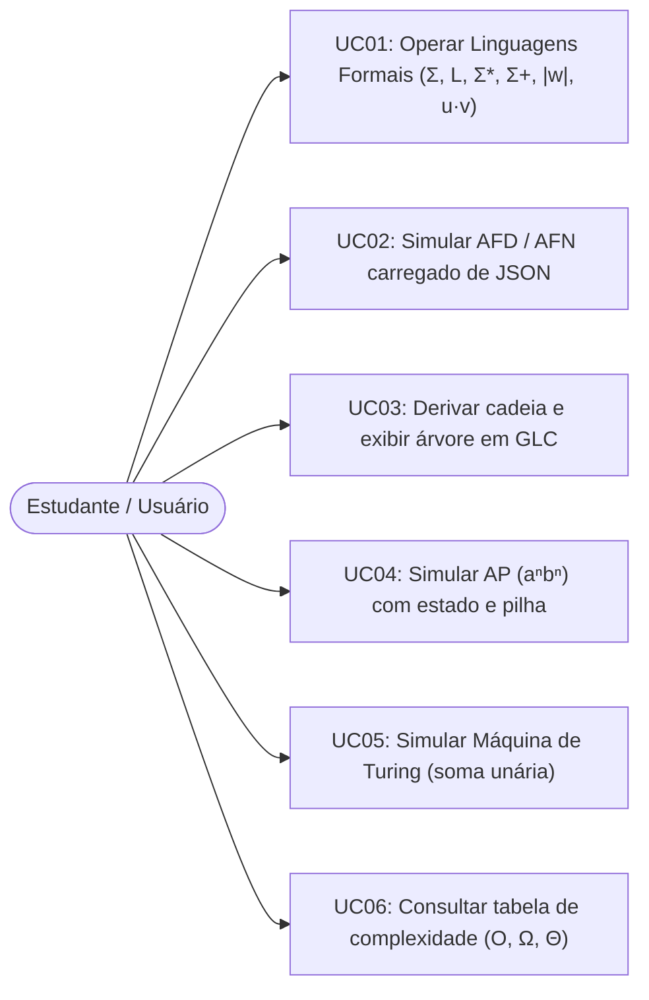

# Documento Técnico — StateLab: Simulador de Linguagens Formais e Modelos Computacionais

- **Disciplina:** Aspectos Teóricos da Computação (AV3)
- **Professor:** Ildo Ramos Vieira
- **Alunos:**
  - Gigio Moura Melo — Matrícula: 2410408
  - Aaron Magno Campos Nogueira — Matrícula: 2413085
- **Repositório:** https://github.com/gigio-mm/StateLab

---

## 1. Introdução

### 1.1 Problema

O estudo de Teoria da Computação envolve conceitos abstratos — como alfabetos, fechos de Kleene, autômatos finitos determinísticos e não determinísticos, gramáticas livres de contexto, autômatos com pilha e máquinas de Turing — cuja compreensão apenas no papel pode ser difícil para estudantes. A ausência de visualização imediata do passo a passo de transições, derivações e manipulações de pilha/fita dificulta a validação do aprendizado.

### 1.2 Objetivos

Desenvolver o **StateLab**, uma ferramenta educacional em TypeScript executada via console que permite:

1. Definir alfabetos $\Sigma$ e linguagens formais $L$, validar cadeias e calcular $|w|$, concatenação, $\Sigma^*$ e $\Sigma^+$;
2. Carregar por JSON e simular passo a passo Autômatos Finitos Determinísticos (AFD) e Não Determinísticos (AFN);
3. Carregar e simular Gramáticas Livres de Contexto (GLC), exibindo a derivação mais à esquerda e a árvore de derivação simplificada;
4. Simular um Autômato com Pilha (AP) para $L = \{ a^n b^n \mid n \ge 1 \}$, detalhando leitura, estado e conteúdo da pilha;
5. Simular uma Máquina de Turing para soma de dois números em representação unária (Opção B);
6. Apresentar a análise assintótica de complexidade ($O$, $\Omega$, $\Theta$) no melhor, médio e pior caso de cada algoritmo.

---

## 2. Fundamentação Teórica

### 2.1 Linguagens Formais

- **Alfabeto ($\Sigma$):** conjunto finito e não vazio de símbolos.
- **Cadeia ($w$):** sequência finita de símbolos de $\Sigma$. O comprimento $|w|$ indica a quantidade de símbolos, e $\lambda$ representa a cadeia vazia ($|\lambda| = 0$).
- **Fecho Positivo ($\Sigma^+$) e Fecho de Kleene ($\Sigma^\*$):** $\Sigma^+$ é o conjunto de todas as cadeias não vazias sobre $\Sigma$, e $\Sigma^* = \Sigma^+ \cup \{\lambda\}$.
- **Linguagem Formal ($L$):** qualquer subconjunto $L \subseteq \Sigma^*$.

### 2.2 Autômatos Finitos (AFD e AFN)

Um Autômato Finito é uma 5-tupla $M = (Q, \Sigma, \delta, q_0, F)$, onde $Q$ é o conjunto finito de estados, $\Sigma$ é o alfabeto de entrada, $q_0 \in Q$ é o estado inicial e $F \subseteq Q$ é o conjunto de estados finais. No AFD, $\delta: Q \times \Sigma \to Q$ retorna no máximo um estado destino; no AFN, $\delta: Q \times (\Sigma \cup \{\lambda\}) \to \mathcal{P}(Q)$ permite múltiplos estados ativos simultaneamente, reconhecendo a classe das **Linguagens Regulares**.

### 2.3 Gramáticas Livres de Contexto (GLC) e Autômatos com Pilha (AP)

- **GLC:** uma 4-tupla $G = (V, \Sigma, P, S)$, onde $V$ são as variáveis não terminais, $\Sigma$ os terminais, $P$ as produções na forma $A \to \alpha$ ($\alpha \in (V \cup \Sigma)^*$) e $S \in V$ o símbolo inicial. Gera as **Linguagens Livres de Contexto**.
- **Autômato com Pilha (AP):** adiciona aos autômatos finitos uma memória auxiliar em formato de pilha (LIFO), permitindo reconhecer linguagens que exigem contagem balanceada, como $L = \{ a^n b^n \mid n \ge 1 \}$.

### 2.4 Máquinas de Turing (MT)

Definida por $M = (Q, \Sigma, \Gamma, \delta, q_0, B, F)$, a Máquina de Turing possui uma fita ilimitada de leitura e escrita com cabeçote bidirecional ($\delta: Q \times \Gamma \to Q \times \Gamma \times \{E, D, P\}$). Além de reconhecer linguagens recursivamente enumeráveis, computa funções como a adição em notação unária.

---

## 3. Arquitetura

A aplicação foi estruturada de forma enxuta, com um arquivo TypeScript por módulo do enunciado e retorno padronizado `ResultadoSimulacao = { aceita: boolean; passos: string[] }`.

### 3.1 Casos de Uso

### 3.2 Diagrama UML de Módulos e Tipos

```mermaid
classDiagram
  direction TB

  class ResultadoSimulacao {
    +aceita: boolean
    +passos: string[]
  }

  class ModuloLinguagens {
    <<src/linguagens.ts>>
    +tamanhoCadeia(cadeia: string) number
    +validarCadeia(alfabeto: string[], cadeia: string) boolean
    +pertenceLinguagem(linguagem: string[], cadeia: string) boolean
    +concatenar(u: string, v: string) string
    +gerarFechoPositivo(alfabeto: string[], ateTamanho: number) string[]
    +gerarEstrelaKleene(alfabeto: string[], ateTamanho: number) string[]
    +analisarCadeia(alfabeto: string[], cadeia: string, linguagem?: string[]) ResultadoSimulacao
  }

  class Automato {
    <<src/automato.ts>>
    +estados: string[]
    +alfabeto: string[]
    +estadoInicial: string
    +estadosFinais: string[]
    +transicoes: Record~string, Record~string, string[]~~
    +carregarAutomatoJson(caminho: string) Automato
    +simularAutomato(automato: Automato, cadeia: string) ResultadoSimulacao
  }

  class Gramatica {
    <<src/gramatica.ts>>
    +variaveis: string[]
    +terminais: string[]
    +simboloInicial: string
    +producoes: Record~string, string[]~
    +carregarGramaticaJson(caminho: string) Gramatica
    +simularGramatica(gramatica: Gramatica, cadeia: string) ResultadoSimulacao
  }

  class ModuloPilha {
    <<src/pilha.ts>>
    +empilhar(pilha: string[], simbolo: string) void
    +desempilhar(pilha: string[]) string
    +simularPilha(cadeia: string) ResultadoSimulacao
  }

  class ModuloTuring {
    <<src/turing.ts>>
    +simularTuring(cadeia: string) ResultadoSimulacao
  }

  class ModuloComplexidade {
    <<src/complexidade.ts>>
    +TABELA_COMPLEXIDADE: ItemComplexidade[]
    +exibirTabelaComplexidade() void
  }

  class MenuCLI {
    <<src/cli.ts>>
    +iniciarMenu() Promise~void~
  }

  MenuCLI --> ModuloLinguagens
  MenuCLI --> Automato
  MenuCLI --> Gramatica
  MenuCLI --> ModuloPilha
  MenuCLI --> ModuloTuring
  MenuCLI --> ModuloComplexidade
```

---

## 4. Implementação

### 4.1 Estruturas de Dados Utilizadas

| Módulo          | Arquivo               | Estrutura Principal                         | Finalidade                                                                           |
| --------------- | --------------------- | ------------------------------------------- | ------------------------------------------------------------------------------------ |
| 1. Linguagens   | `src/linguagens.ts`   | `Set<string>` e `string[]`                  | Busca $O(1)$ de símbolos em $\Sigma$ e geração em camadas de $\Sigma^*$ e $\Sigma^+$ |
| 2. Autômatos    | `src/automato.ts`     | `Record<string, Record<string, string[]>>`  | Tabela de transições unificada para AFD e AFN                                        |
| 3. Gramática    | `src/gramatica.ts`    | Fila (`EstadoBusca[]`) e `Set<string>`      | Busca em largura (BFS) de derivações sem repetir formas sentenciais                  |
| 4. Pilha (AP)   | `src/pilha.ts`        | Array `string[]` (`push`/`pop`)             | Pilha LIFO explícita com `empilhar` e `desempilhar`                                  |
| 5. Turing       | `src/turing.ts`       | Array `string[]` + índice numérico `cabeca` | Fita bidirecional expansível com símbolo branco `_`                                  |
| 6. Complexidade | `src/complexidade.ts` | `ItemComplexidade[]`                        | Tabela assintótica exibida via `console.table`                                       |

### 4.2 Algoritmos Implementados

1. **Validação e Geração de Fechos (`src/linguagens.ts`):** `validarCadeia` converte $\Sigma$ em um `Set` e verifica cada símbolo da entrada. `gerarFechoPositivo` constrói iterativamente as palavras de tamanho $1$ a $k$ concatenando cada símbolo de $\Sigma$ às palavras do nível anterior.
2. **Simulação Unificada AFD/AFN (`src/automato.ts`):** `simularAutomato` mantém a lista de estados ativos (iniciando no fecho-$\lambda$ de $q_0$). A cada símbolo lido, une os estados de destino e aplica o fecho-$\lambda$, registrando o caminho `q0 -> q1 -> q2` e aceitando se algum estado final estiver ativo ao término da cadeia.
3. **Derivação Mais à Esquerda com Poda (`src/gramatica.ts`):** `simularGramatica` executa uma busca em largura (BFS) expandindo sempre a primeira variável da forma sentencial. A função `podeGerarAlvo` poda formas cujo número de terminais excede $|w|$ ou cujo prefixo terminal diverge de $w$. Ao atingir $w$, `montarArvoreTexto` reconstrói a árvore indentada a partir das regras usadas.
4. **Simulação de AP para $a^n b^n$ (`src/pilha.ts`):** `simularPilha` percorre a entrada mantendo o estado (`q0` na leitura de `a`, `q1` na leitura de `b`) e uma pilha onde cada `a` empilha `A` e cada `b` desempilha `A`, aceitando em `q1` com pilha vazia.
5. **Soma Unária na Máquina de Turing (`src/turing.ts`):** `simularTuring` percorre os `0`s do primeiro número em `q0`, substitui o separador `1` por `0` indo para `q1`, avança até o branco `_` final, recua uma posição em `q2`, apaga o último `0` e para no estado de aceitação `qf`.

---

## 5. Complexidade Computacional

Considere $n = |w|$ (comprimento da cadeia de entrada), $|\Sigma|$ o tamanho do alfabeto, $|Q|$ o número de estados, $b$ o fator máximo de ramificação das produções da GLC e $d$ a profundidade da derivação.

| Algoritmo                                      | Melhor Caso ($\Omega$) | Caso Médio ($\Theta$)   | Pior Caso ($O$)      | Justificativa                                                                                                                         |
| ---------------------------------------------- | ---------------------- | ----------------------- | -------------------- | ------------------------------------------------------------------------------------------------------------------------------------- |
| **M1: Validar cadeia em $\Sigma^\*$**          | $\Omega(1)$            | $\Theta(n)$             | $O(n)$               | Consulta em `Set` é $O(1)$; para no 1º símbolo inválido (melhor) ou lê $n$ símbolos (pior).                                           |
| **M1: Gerar $\Sigma^\*$ e $\Sigma^+$ até $k$** | $\Omega(\|\Sigma\|^k)$ | $\Theta(\|\Sigma\|^k)$  | $O(\|\Sigma\|^k)$    | Sempre gera todas as $\sum_{i=1}^{k} \|\Sigma\|^i = \Theta(\|\Sigma\|^k)$ cadeias.                                                    |
| **M1: Tamanho e concatenação**                 | $\Omega(1)$            | $\Theta(\|u\|+\|v\|)$   | $O(\|u\|+\|v\|)$     | Tamanho é propriedade da string; concatenação copia os caracteres de $u$ e $v$.                                                       |
| **M2: Simulação AFD / AFN**                    | $\Omega(1)$            | $\Theta(n \cdot \|Q\|)$ | $O(n \cdot \|Q\|^2)$ | Para cada um dos $n$ símbolos, percorre até $\|Q\|$ estados ativos e suas transições (no AFD puro, $\|Q\|$ ativo $= 1$, logo $O(n)$). |
| **M3: Derivação GLC (BFS c/ poda)**            | $\Omega(n)$            | $\Theta(b^d)$           | $O(b^d)$             | Gramáticas determinísticas expandem linearmente; no pior caso a busca em largura explora até $b^d$ formas sentenciais.                |
| **M4: Simulação AP ($a^n b^n$)**               | $\Omega(1)$            | $\Theta(n)$             | $O(n)$               | Cada símbolo executa uma busca constante na tabela de 3 regras e `push`/`pop` em $O(1)$.                                              |
| **M5: Máquina de Turing (soma unária)**        | $\Omega(1)$            | $\Theta(n)$             | $O(n)$               | O cabeçote percorre os $n$ símbolos até o branco no fim da fita e recua 1 célula ($n + 2$ passos).                                    |

---

## 6. Conclusão

O **StateLab** cumpre todos os requisitos funcionais e técnicos propostos na disciplina de Aspectos Teóricos da Computação, permitindo experimentar na prática a Hierarquia de Chomsky (Linguagens Regulares com AFD/AFN, Livres de Contexto com GLC/AP e Recursivamente Enumeráveis com Máquina de Turing) e relacionar cada modelo à sua complexidade assintótica. A escolha de uma arquitetura enxuta em TypeScript, com um módulo por arquivo e saída passo a passo padronizada, tornou o código direto, testável e simples de demonstrar.

---

## Referências

- SIPSER, Michael. _Introdução à Teoria da Computação_. 2ª ed. São Paulo: Cengage Learning, 2007.
- HOPCROFT, John E.; ULLMAN, Jeffrey D.; MOTWANI, Rajeev. _Introdução à Teoria de Autômatos, Linguagens e Computação_. 2ª ed. Rio de Janeiro: Elsevier, 2002.
- MENEZES, Paulo Blauth. _Linguagens Formais e Autômatos_. 6ª ed. Porto Alegre: Bookman, 2010.
