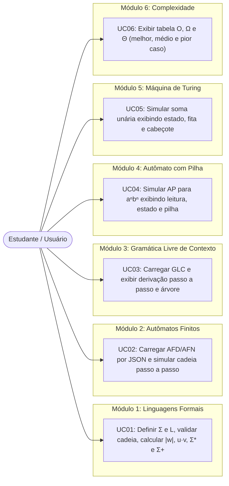
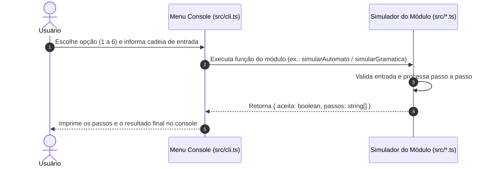

# Modelagem UML — StateLab

Diagramas UML atualizados refletindo a arquitetura enxuta em `src/`.

## 1. Casos de Uso (`casos-de-uso.mmd`)

## 2. Diagrama de Módulos e Tipos (`classes.mmd`)

```mermaid
classDiagram
  direction TB

  class ResultadoSimulacao {
    +aceita: boolean
    +passos: string[]
  }

  class ModuloLinguagens {
    <<src/linguagens.ts>>
    +tamanhoCadeia(cadeia: string) number
    +validarCadeia(alfabeto: string[], cadeia: string) boolean
    +pertenceLinguagem(linguagem: string[], cadeia: string) boolean
    +concatenar(u: string, v: string) string
    +gerarFechoPositivo(alfabeto: string[], ateTamanho: number) string[]
    +gerarEstrelaKleene(alfabeto: string[], ateTamanho: number) string[]
    +analisarCadeia(alfabeto: string[], cadeia: string, linguagem?: string[]) ResultadoSimulacao
  }

  class Automato {
    <<src/automato.ts>>
    +estados: string[]
    +alfabeto: string[]
    +estadoInicial: string
    +estadosFinais: string[]
    +transicoes: Record~string, Record~string, string[]~~
    +carregarAutomatoJson(caminho: string) Automato
    +simularAutomato(automato: Automato, cadeia: string) ResultadoSimulacao
  }

  class Gramatica {
    <<src/gramatica.ts>>
    +variaveis: string[]
    +terminais: string[]
    +simboloInicial: string
    +producoes: Record~string, string[]~
    +carregarGramaticaJson(caminho: string) Gramatica
    +simularGramatica(gramatica: Gramatica, cadeia: string) ResultadoSimulacao
  }

  class ModuloPilha {
    <<src/pilha.ts>>
    +empilhar(pilha: string[], simbolo: string) void
    +desempilhar(pilha: string[]) string
    +simularPilha(cadeia: string) ResultadoSimulacao
  }

  class ModuloTuring {
    <<src/turing.ts>>
    +simularTuring(cadeia: string) ResultadoSimulacao
  }

  class ModuloComplexidade {
    <<src/complexidade.ts>>
    +TABELA_COMPLEXIDADE: ItemComplexidade[]
    +exibirTabelaComplexidade() void
  }

  class MenuCLI {
    <<src/cli.ts>>
    +iniciarMenu() Promise~void~
  }

  MenuCLI --> ModuloLinguagens
  MenuCLI --> Automato
  MenuCLI --> Gramatica
  MenuCLI --> ModuloPilha
  MenuCLI --> ModuloTuring
  MenuCLI --> ModuloComplexidade
  ModuloLinguagens ..> ResultadoSimulacao
  Automato ..> ResultadoSimulacao
  Gramatica ..> ResultadoSimulacao
  ModuloPilha ..> ResultadoSimulacao
  ModuloTuring ..> ResultadoSimulacao
```

## 3. Diagrama de Sequência (`sequencia.mmd`)

