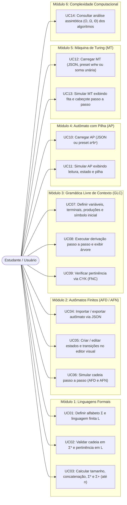
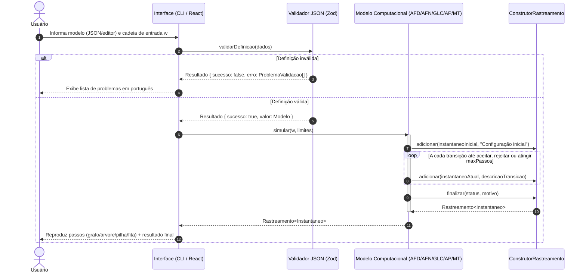

# Modelagem UML — StateLab

Este diretório contém os diagramas UML da arquitetura do **StateLab** (arquivos `.mmd` puros e versão renderizável abaixo).

---

## 1. Diagrama de Casos de Uso (`casos-de-uso.mmd`)

### Especificação resumida dos Casos de Uso

| Código | Caso de Uso                   | Módulo | Entrada                                                  | Saída                                                                             |
| ------ | ----------------------------- | ------ | -------------------------------------------------------- | --------------------------------------------------------------------------------- |
| UC01   | Definir Σ e L                 | 1      | Conjunto de símbolos Σ e conjunto finito de cadeias L    | Instâncias validadas de `Alfabeto` e `LinguagemFormal`                            |
| UC02   | Validar cadeia em Σ* e L      | 1      | Cadeia `w`                                               | Validade em Σ*, símbolos inválidos (se houver) e pertinência `w ∈ L`              |
| UC03   | Operações sobre cadeias e Σ   | 1      | Cadeias `u`, `v` e limite `n`                            | `\|u\|`, `u·v`, listagem de `Σ*` e `Σ+` até comprimento `n`                       |
| UC04   | Importar/exportar AF por JSON | 2      | Arquivo/texto JSON                                       | `AutomatoFinito` validado ou lista de `ProblemaValidacao`                         |
| UC05   | Editar autômato visualmente   | 2      | Interações no grafo (estados/transições)                 | Definição sincronizada com o JSON                                                 |
| UC06   | Simular AFD / AFN             | 2      | `AutomatoFinito` e cadeia `w`                            | `Rastreamento<InstantaneoAF>` com transições passo a passo e `ACEITA`/`REJEITADA` |
| UC07   | Definir GLC                   | 3      | Variáveis `V`, terminais `Σ`, produções `P`, inicial `S` | `GramaticaLivreContexto` validada                                                 |
| UC08   | Derivar cadeia e gerar árvore | 3      | `GramaticaLivreContexto` e cadeia `w`                    | Passos da derivação mais à esquerda e árvore de derivação simplificada            |
| UC09   | Reconhecer cadeia com CYK     | 3      | `GramaticaLivreContexto` e cadeia `w`                    | Gramática em FNC, tabela CYK e decisão de aceitação                               |
| UC10   | Carregar AP                   | 4      | JSON ou preset `L = { aⁿbⁿ \| n ≥ 1 }`                   | `AutomatoComPilha` validado                                                       |
| UC11   | Simular AP                    | 4      | `AutomatoComPilha` e cadeia `w`                          | `Rastreamento<InstantaneoAP>` com leitura, estado e conteúdo da pilha             |
| UC12   | Carregar Máquina de Turing    | 5      | JSON, preset `w#w` (Opção A) ou soma unária (Opção B)    | `MaquinaDeTuring` validada                                                        |
| UC13   | Simular Máquina de Turing     | 5      | `MaquinaDeTuring` e cadeia na fita                       | `Rastreamento<InstantaneoMT>` com fita, posição do cabeçote e resultado final     |
| UC14   | Consultar complexidade        | 6      | Seleção de módulo/algoritmo                              | Tabela com melhor, médio e pior caso em `O()`, `Ω()` e `Θ()`                      |

---

## 2. Diagrama de Classes (`classes.mmd`)

```mermaid
classDiagram
  direction TB

  class Passo~Instantaneo~ {
    +indice: number
    +instantaneo: Instantaneo
    +descricao: string
  }

  class Rastreamento~Instantaneo~ {
    +passos: Passo~Instantaneo~[]
    +status: StatusSimulacao
    +aceita: boolean
    +motivo: string
  }

  class ConstrutorRastreamento~Instantaneo~ {
    +adicionar(instantaneo: Instantaneo, descricao: string) Passo~Instantaneo~
    +finalizar(status: StatusSimulacao, motivo: string) Rastreamento~Instantaneo~
  }

  class Alfabeto {
    +simbolos: Set~string~
    +contemSimbolo(simbolo: string) boolean
    +validarCadeia(cadeia: string) boolean
    +gerarEstrelaKleene(ateTamanho: number) string[]
    +gerarFechoPositivo(ateTamanho: number) string[]
  }

  class LinguagemFormal {
    +alfabeto: Alfabeto
    +palavras: Set~string~
    +pertence(cadeia: string) boolean
    +tamanhoCadeia(cadeia: string) number
    +concatenar(u: string, v: string) string
  }

  class AutomatoFinito {
    +estados: Set~string~
    +alfabeto: Alfabeto
    +estadoInicial: string
    +estadosFinais: Set~string~
    +transicoes: TransicaoAF[]
    +ehDeterministico() boolean
    +fechoEpsilon(estados: Set~string~) Set~string~
    +simular(cadeia: string, limites?: LimitesSimulacao) Rastreamento~InstantaneoAF~
  }

  class GramaticaLivreContexto {
    +variaveis: Set~string~
    +terminais: Alfabeto
    +producoes: ProducaoGLC[]
    +simboloInicial: string
    +derivarMaisAEsquerda(cadeia: string, limites?: LimitesSimulacao) Rastreamento~InstantaneoGLC~
    +converterParaFNC() GramaticaLivreContexto
    +reconhecerCYK(cadeia: string) ResultadoCYK
  }

  class AutomatoComPilha {
    +estados: Set~string~
    +alfabetoEntrada: Alfabeto
    +alfabetoPilha: Alfabeto
    +estadoInicial: string
    +simboloInicialPilha: string
    +estadosFinais: Set~string~
    +modoAceitacao: ModoAceitacaoAP
    +transicoes: TransicaoAP[]
    +simular(cadeia: string, limites?: LimitesSimulacao) Rastreamento~InstantaneoAP~
  }

  class MaquinaDeTuring {
    +estados: Set~string~
    +alfabetoEntrada: Alfabeto
    +alfabetoFita: Alfabeto
    +estadoInicial: string
    +estadosAceitacao: Set~string~
    +estadosRejeicao: Set~string~
    +simboloBranco: string
    +transicoes: TransicaoMT[]
    +simular(cadeia: string, limites?: LimitesSimulacao) Rastreamento~InstantaneoMT~
  }

  Rastreamento *-- Passo
  ConstrutorRastreamento ..> Rastreamento : cria
  LinguagemFormal *-- Alfabeto
  AutomatoFinito *-- Alfabeto
  AutomatoFinito ..> Rastreamento : produz
  GramaticaLivreContexto *-- Alfabeto
  GramaticaLivreContexto ..> Rastreamento : produz
  AutomatoComPilha *-- Alfabeto
  AutomatoComPilha ..> Rastreamento : produz
  MaquinaDeTuring *-- Alfabeto
  MaquinaDeTuring ..> Rastreamento : produz
```

---

## 3. Diagrama de Sequência (`sequencia.mmd`)

